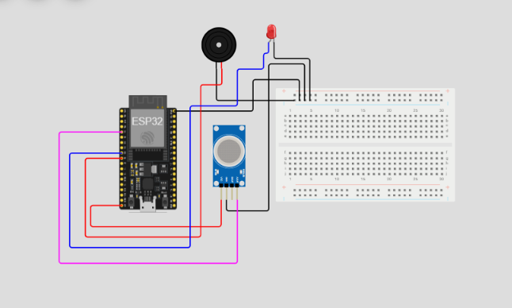

# 🔥 ESP32-Based Smart Gas Leakage Detection and Alert System

An IoT-based gas leakage detection system using **ESP32 and MQ-2 gas sensor**, designed to continuously monitor gas levels and provide immediate alerts through a local LED indicator, buzzer, and Telegram notification.

The project aims to improve safety by detecting abnormal gas levels, classifying danger levels, and notifying users remotely through the internet.

---

## 📌 Project Overview

Gas leakage is a serious safety concern in homes, laboratories, kitchens, and industrial environments. Undetected gas leaks can lead to fire hazards, explosions, and harmful exposure.

This project introduces a smart gas leakage detection system using an ESP32 microcontroller and an MQ-2 gas sensor.

The sensor continuously measures the surrounding gas level and sends its analog readings to the ESP32. Based on predefined threshold values, the system categorizes the detected gas level into three warning categories:

- **Lowest Danger – Warning**
- **Medium Danger**
- **Highest Danger – Critical**

When a critical gas level is detected, the system activates an LED blinking indicator and an audible buzzer alarm. It also sends Telegram notifications to the configured user, providing the sensor reading, danger category, potential risks, and recommended safety actions.

The system is designed with future scope for a 3D-printed enclosure and expansion into a reusable IoT-based monitoring platform.

---

## ✨ Features

- Continuous gas-level monitoring using MQ-2.
- ESP32-based sensor data processing.
- Three-level danger classification.
- Real-time LED warning indication.
- Audible alarm using an active buzzer.
- Telegram notifications through Wi-Fi.
- Repeated alerts at predefined intervals.
- Automatic alarm deactivation when the gas reading returns below the reset threshold.
- Compact hardware design with potential for a custom 3D-printed enclosure.

---

## 🧰 Components Used

| Component | Quantity | Purpose |
|---|---:|---|
| ESP32 DevKit V1 | 1 | Main microcontroller |
| MQ-2 Gas Sensor | 1 | Detects combustible gases and smoke |
| Red LED | 1 | Visual warning indication |
| Active Buzzer | 1 | Audible warning |
| Breadboard | 1 | Circuit assembly |
| Jumper Wires | As required | Electrical connections |
| USB Cable | 1 | Programming and power |
| 220Ω Resistor | 1 | LED current limiting |
| 10kΩ Resistor | 1 | Voltage divider |
| 20kΩ Resistor | 1 | Voltage divider |

*Note: The voltage-divider resistors are required for the real hardware implementation when the MQ-2 analog output can reach 5V. The Wokwi circuit does not include this protection.*

---

## 🔌 Circuit Connections

### ESP32 Pin Configuration

| Component | Component Pin | ESP32 Pin |
|---|---|---|
| MQ-2 | VCC | 5V |
| MQ-2 | GND | GND |
| MQ-2 | AOUT | GPIO 34 |
| LED | Anode (+) | GPIO 25 through 220Ω |
| LED | Cathode (-) | GND |
| Active Buzzer | Positive (+) | GPIO 26 |
| Active Buzzer | Negative (-) | GND |

**Important for physical hardware:** Connect the MQ-2 AOUT to GPIO34 through a voltage divider. For example, use 10kΩ between AOUT and GPIO34 and 20kΩ between GPIO34 and GND. Never apply a possible 5V signal directly to an ESP32 GPIO.

---

## 🖥️ Circuit Diagram – Wokwi Simulation

The circuit was initially designed and tested in the Wokwi online electronics simulator.

<!-- Replace the placeholder below with your Wokwi circuit screenshot -->



**Wokwi Project:** [Our Wokwi Project](https://wokwi.com/projects/479371518161693697)

---

## ⚙️ Working Principle

1. The MQ-2 sensor continuously monitors the surrounding environment.
2. The analog sensor output is read by ESP32 through GPIO34.
3. ESP32 processes the readings and compares them with predefined threshold values.
4. The system identifies the corresponding danger category.
5. When a warning-level reading is detected, a Telegram notification is sent.
6. When a critical level is detected, the LED starts blinking and the buzzer produces an audible warning.
7. Telegram alerts are repeated at predefined intervals while the warning condition continues.
8. When the reading remains below the alarm reset threshold for the specified duration, the local alarm is deactivated.

---

## 🚦 Gas Danger Classification

The initial demonstration thresholds are:

| Sensor Reading (ADC) | Danger Level | System Response |
|---:|---|---|
| Below 1200 | Normal | Continuous monitoring |
| 1200–1499 | Lowest Danger | Telegram warning |
| 1500–1799 | Medium Danger | Telegram warning |
| 1800 and above | Highest Danger | Telegram alert, LED blinking and buzzer |

**Note:** These are initial software demonstration thresholds, not calibrated gas concentration values or ppm measurements. Actual thresholds must be established through appropriate sensor calibration and testing.

---

## 📲 Telegram Notification System

Telegram is used to provide remote notifications whenever the sensor detects an elevated gas reading.

Each alert contains:

- Gas sensor reading.
- Detected danger category.
- Potential harmful effects.
- Recommended safety actions.

Example notification:

```text
GAS LEAKAGE ALERT!

Sensor Reading: 1850
Danger Category: HIGHEST DANGER - CRITICAL

POTENTIAL HARM:
Potential serious gas exposure and
fire or explosion risk.

SAFETY ACTION:
Move away immediately. Avoid flames
and electrical switches. Contact
emergency services or a qualified
technician.
```


Telegram integration is implemented using the Telegram Bot API over HTTPS.

---

## 🧠 Algorithm

1. Start the system.
2. Initialize ESP32 GPIO pins and serial communication.
3. Connect ESP32 to the configured Wi-Fi network.
4. Initialize the gas monitoring process.
5. Read the MQ-2 analog sensor value.
6. Compare the reading with the configured thresholds.
7. Classify the gas level:
   - Below 1200: Normal.
   - 1200–1499: Lowest Danger.
   - 1500–1799: Medium Danger.
   - 1800 and above: Highest Danger.
8. Send a Telegram notification when a warning condition is detected, subject to the alert interval.
9. If the reading reaches the critical threshold:
   - Activate LED blinking.
   - Activate the buzzer.
10. Check whether the gas reading remains below the reset threshold for 10 seconds.
11. Deactivate the local alarm when the reset condition is satisfied.
12. Repeat the monitoring process continuously.

---

## 🏗️ Design and Development Plan

The project is developed in the following stages:

| Stage | Development Activity |
|---|---|
| 1 | Identify the gas leakage detection problem |
| 2 | Select ESP32 and MQ-2 sensor |
| 3 | Design the circuit connections |
| 4 | Develop the initial circuit in Wokwi |
| 5 | Program ESP32 using Arduino IDE |
| 6 | Implement gas-level classification |
| 7 | Integrate LED and buzzer alerts |
| 8 | Integrate Telegram notifications |
| 9 | Assemble and test the physical hardware |
| 10 | Design and fabricate a 3D-printed enclosure |
| 11 | Perform final assembly and demonstration |

---

## 🧑‍💻 Software and Development Tools

| Tool / Platform | Application |
|---|---|
| Arduino IDE | ESP32 programming |
| Wokwi | Circuit design and simulation |
| Telegram Bot API | Remote notification |
| C++ (Arduino Framework) | Embedded programming |
| GitHub | Source-code management and documentation |
| 3D CAD Software | Enclosure design |
| 3D Printer | Physical enclosure fabrication |

---

## 💻 Source Code

The complete ESP32 Arduino source code is available in this repository.

**Main source file:** `GasLeakageDetection.ino`

The program includes:

- Wi-Fi connectivity.
- MQ-2 analog sensor reading.
- Gas danger classification.
- LED blinking control.
- Active buzzer control.
- Telegram alert integration.
- Alarm reset logic.

### Required Arduino Libraries

```cpp
#include <WiFi.h>
#include <WiFiClientSecure.h>
#include <HTTPClient.h>
```

These libraries are provided through the ESP32 Arduino board package.

### Upload Instructions

1. Install Arduino IDE.
2. Install the ESP32 board package.
3. Select ESP32 Dev Module.
4. Configure Wi-Fi credentials.
5. Configure Telegram bot credentials.
6. Connect the ESP32 using USB.
7. Select the correct COM port.
8. Compile and upload the program.
9. Open Serial Monitor at 115200 baud.

**Security:** Never commit your real Wi-Fi password or Telegram bot token to a public repository. Use private configuration or a separate secrets file excluded through `.gitignore`.

---

## 🖨️ 3D-Printed Enclosure – Final Assembly

A custom 3D-printed enclosure is planned to house and protect the assembled electronic components.

The enclosure design should provide:

- Proper mounting space for the ESP32 board.
- An opening for the MQ-2 sensing element.
- An opening for the LED indicator.
- Sound openings for the buzzer.
- Access to the USB programming port.
- Suitable ventilation around the gas sensor.
- Space for wiring and electrical connections.

<!-- Replace this placeholder with photographs of your completed 3D-printed enclosure and assembled circuit -->


**Final Assembly Photographs:**
- Front View: Add photograph.
- Side View: Add photograph.
- Internal Electronics: Add photograph.
- Completed Product: Add photograph.

---

## 📁 Repository Structure

```text
ESP32-Gas-Leakage-Detection/
│
├── diagram.json
│
├── wokwi-project.txt
│
├── libraries.txt
│
├── README.md
│
├── images/
│   ├── circuit-diagram.png
│   ├── final-3d-printed-product.jpg
│   ├── front-view.jpg
│   ├── side-view.jpg
│   └── internal-assembly.jpg
│
├── sketch/
│   └── sketch.ino
│
└── .gitignore
```

---

## 🔮 Future Enhancements

- Add a mobile application for live gas monitoring.
- Introduce an IoT dashboard for sensor readings and historical data.
- Add multiple gas sensors for wider monitoring coverage.
- Implement cloud-based data storage.
- Add battery backup for power interruption.
- Improve gas-level calibration and detection reliability.
- Develop a compact, professionally designed 3D-printed enclosure.
- Add additional notification channels.

---

## ⚠️ Safety Disclaimer

This project is an educational IoT prototype. The MQ-2 sensor is sensitive to multiple gases and smoke and cannot independently identify the exact gas or provide certified concentration measurements.

The prototype must not replace certified gas detectors or industrial safety systems. Do not deliberately release flammable gas to test the system. If a real gas leak is suspected, move away, avoid ignition sources, and contact emergency services.

---

## 👨‍💻 Developed By

**Anal Johny W R** 

**Joel John Jobinse**

B.E. Electronics and Communication Engineering

B.Tech. Artificial Intelligence and Machine Learning

Saveetha Engineering College

**Project Domain:** Embedded Systems | Internet of Things (IoT) | Smart Safety Systems

---

## 📜 License

This project is intended for educational, learning, and research purposes.

You may adapt and improve the project with appropriate attribution.
